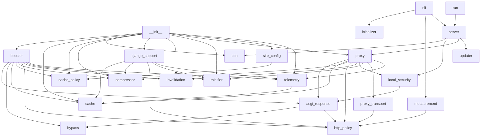

# Code Map

Generated with `python refresh_docs.py`.

## booster/__init__.py

- `__getattr__` (line 33): Load optional integrations only when requested, preserving public exports.

## booster/asgi_response.py

- `parse_headers` (line 10): Combine repeated fields so restrictive cache directives cannot be hidden.
- `ASGIResponseOptimizer` (line 20): Capture one bounded response and optimize public or dynamic representations.
- `representation_headers` (line 150): Replace length, validators and negotiation fields after changing a body.
- `__init__` (line 23): Keep request state separate from the shared middleware instance.
- `__call__` (line 33): Forward streams and extensions immediately, optimizing a single body.
- `_start_response` (line 50): Decide eligibility once using both request and response privacy rules.
- `_record_response_reason` (line 68): Explain why an eligible request was not stored.
- `_collect_body` (line 78): Buffer bounded public static files while forwarding dynamic streams promptly.
- `_record_body_reason` (line 98): Explain why an eligible response body was not buffered.
- `_optimized_cacheable` (line 107): Minify and compress public bytes, preserving unrelated response fields.
- `_optimized_dynamic` (line 129): Compress private dynamic bytes without storing in shared cache.

## booster/booster.py

- `RocketBooster` (line 24): Accelerate public and static responses and adaptively optimize dynamic traffic.
- `__init__` (line 27): Initialize bounded caches or share the instance exposed by attach.
- `attach` (line 57): Register middleware and expose the cache actually serving the app.
- `cache_key` (line 65): Isolate representations by scheme, host, path and query.
- `__call__` (line 72): Accelerate static and public reads, optimize dynamic responses, and handle mutations.
- `_bypass_reason` (line 102): Explain why this request may not use the shared cache.
- `_handle_mutation` (line 112): Invalidate before and after writes, including failed or concurrent writes.
- `_invalidate` (line 122): Keep full invalidation safe by default for cross-route dependencies.
- `publish_invalidation` (line 131): Tell the other workers that cached reads are no longer valid.
- `apply_pending_invalidations` (line 136): Apply the invalidation notices published by the other workers.
- `clear_cache` (line 146): Clear the local cache and tell the other workers to clear theirs.
- `_handle_get` (line 151): Serve a public cached representation or its conditional response.
- `_send_304` (line 175): Retain origin cache and security headers on conditional cache hits.
- `_age_value` (line 185): Report the origin age plus the time the entry spent in this cache.
- `_send_cached` (line 196): Send cached content with validators matching the transformed bytes.
- `_passthrough_and_cache` (line 204): Optimize a bounded response while respecting ASGI streaming semantics.
- `get_status` (line 209): Return a host-dashboard snapshot without credentials, URLs or payloads.

## booster/bypass.py

- `BypassTracker` (line 25): Accumulate bounded reason counters for the served responses.
- `__init__` (line 28): Start with empty counters.
- `record` (line 33): Count one decision for a served response.
- `get_counts` (line 38): Return the reason counters as a stable sorted mapping.
- `reset` (line 43): Clear every counter.

## booster/cache.py

- `synchronized` (line 13): Serialize cache operations across worker threads.
- `CacheEntry` (line 24): Cached response item with metadata and expiration.
- `FastMemoryCache` (line 40): Thread-safe LRU in-memory cache supporting TTL and key invalidation.
- `guarded` (line 16): Hold the cache lock for the complete operation.
- `is_expired` (line 35): Check if entry has outlived its time to live.
- `__init__` (line 43): Initialize item and byte budgets with a monotonic default expiration.
- `compute_etag` (line 60): Generate a fast ETag for binary payload.
- `make_key` (line 65): Generate unique cache key based on request parameters.
- `get` (line 71): Retrieve entry by key if valid and not expired.
- `set` (line 83): Insert or update a cache entry with LRU eviction.
- `_insert_entry` (line 107): Insert one entry with LRU eviction under the caller's cache lock.
- `_entry_size` (line 120): Include response bodies and headers in the memory budget.
- `set_if_current` (line 125): Reject responses fetched before an invalidation or target change.
- `delete` (line 130): Remove single entry by key.
- `invalidate_path_prefix` (line 139): Invalidate all cached items whose original path starts with prefix.
- `clear` (line 148): Clear all cached entries.
- `count` (line 156): Return count of active entries.
- `get_stats` (line 161): Expose bounded resident memory counters without cache keys or payloads.

## booster/cache_policy.py

- `CachePolicy` (line 7): Allow optional route prefixes and let exclusions always take precedence.
- `__post_init__` (line 13): Reject ambiguous prefixes before middleware starts serving traffic.
- `allows` (line 20): Match complete route names or explicitly slash-terminated subtrees.
- `_matches` (line 28): Keep /public from accidentally matching /public-private.

## booster/cdn.py

- `CDNConfig` (line 14): Configuration for CDN automated cache synchronization.
- `CDNManager` (line 45): Zero-overhead multi-CDN cache purger and header generator.
- `from_env` (line 22): Auto-detect CDN credentials from environment variables.
- `__init__` (line 48): Internal implementation.
- `get_cdn_headers` (line 52): Return standardized edge caching headers compatible with all major CDNs.
- `purge_all` (line 59): Asynchronously purge edge cache across configured CDN provider.
- `_purge_cloudflare` (line 89): Purge Cloudflare Zone Cache via Client v4 API.
- `_purge_bunny` (line 99): Purge BunnyCDN Pull Zone Cache.
- `_purge_fastly` (line 106): Purge Fastly Service Cache.

## booster/cli.py

- `run_init` (line 8): Generate a Booster adapter inside the host project.
- `run_measure` (line 31): Measure one URL and report whether the engine could store it.
- `main` (line 45): Delegate to the server without loading its dependencies on core import.

## booster/compressor.py

- `is_compressible` (line 30): Determine if content type and payload size qualify for compression.
- `choose_encoding` (line 38): Select the best compression algorithm supported by client.
- `compress_payload` (line 59): Compress bytes using chosen encoding.
- `ResponseCompressor` (line 70): Handles adaptive payload compression according to client headers.
- `__init__` (line 73): Set the minimum payload size eligible for public-response compression.
- `compress` (line 77): Compress content if eligible, returning compressed bytes and encoding.

## booster/django_support.py

- `DjangoRocketMiddleware` (line 12): Cache only explicitly public, bounded and non-streaming Django responses.
- `__init__` (line 15): Initialize the downstream callable and bounded optimization services.
- `__call__` (line 24): Bypass personalized requests and invalidate derived reads around writes.
- `_cached_response` (line 47): Restore headers with a length matching the cached representation.
- `_store_response` (line 58): Cache only a public response and correct validators after minification.

## booster/http_policy.py

- `is_static_asset` (line 13): Check if the path represents an immutable or public static asset.
- `cache_directives` (line 19): Parse case-insensitive cache directive names without substring matches.
- `request_cacheable` (line 25): Exclude personalized, conditional and explicitly uncached requests.
- `response_age` (line 37): Read the Age header as the number of seconds the response is already old.
- `response_cacheable` (line 45): Store only responses safe for a shared representation cache.
- `response_ttl` (line 67): Bound static cache retention by the shortest declared freshness limit.
- `filtered_headers` (line 80): Remove hop-by-hop fields including fields nominated by Connection.
- `merge_vary` (line 88): Preserve existing negotiation fields while adding compression.

## booster/initializer.py

- `render_paths` (line 73): Render a path tuple for the generated module.
- `render_adapter` (line 80): Render the adapter source for the requested route policy.
- `write_adapter` (line 86): Write the adapter into a host project without overwriting existing work.
- `write_config` (line 97): Write the matching JSON site configuration into a host project.

## booster/invalidation.py

- `InvalidationBus` (line 16): Publish and observe invalidation notices.
- `LocalInvalidationBus` (line 26): Keep invalidation inside the current process.
- `FileInvalidationBus` (line 36): Exchange notices through one shared file, for workers on the same host.
- `publish` (line 19): Publish one notice for the other workers.
- `drain` (line 22): Return the notices published since the last drain.
- `publish` (line 29): Ignore the notice because no other worker exists.
- `drain` (line 32): Return no notices.
- `__init__` (line 45): Open the shared notice file for reading and later appending.
- `publish` (line 53): Append one notice for the other workers.
- `drain` (line 59): Read the notices written since the last drain.
- `_truncate_if_large` (line 66): Truncate the notice file so it cannot grow without bound.

## booster/local_security.py

- `validate_target` (line 14): Reject credentials, malformed ports, special networks and gateway loops.
- `LocalAccessGuard` (line 38): Block remote clients, DNS rebinding and browser requests from other origins.
- `__init__` (line 41): Select management restrictions or the isolated gateway access policy.
- `__call__` (line 45): Validate raw host and peer before routing any HTTP request.
- `_error` (line 66): Return the precise failed local browser access boundary.
- `secure_send` (line 55): Make management responses private and prevent framing or sniffing.

## booster/measurement.py

- `_headers` (line 22): Lowercase the response headers for the engine's policy rules.
- `fetch_once` (line 27): Fetch the URL once and return its status, headers, size and duration.
- `percentile` (line 39): Return one percentile of the measured durations.
- `cache_verdict` (line 48): Explain whether the engine could store this response and for how long.
- `measure` (line 61): Measure one URL repeatedly and return a structured report.
- `hosting_hint` (line 85): Explain a refusal that an upstream proxy may have caused.
- `format_report` (line 102): Render the report as a short operator-friendly text block.
- `measure_or_error` (line 121): Measure the URL and return None when it cannot be reached.

## booster/minifier.py

- `minify_html` (line 9): Preserve HTML verbatim; regex rewriting can change markup and text meaning.
- `minify_css` (line 14): Preserve CSS verbatim; selectors and custom properties depend on whitespace.
- `minify_json` (line 19): Remove JSON whitespace without rounding numbers or rewriting string values.
- `FastMinifier` (line 28): Optimize UTF-8 JSON while preserving all other content byte for byte.
- `minify` (line 32): Remove only insignificant JSON whitespace from explicitly UTF-8 content.

## booster/proxy.py

- `RejectCookies` (line 26): Never retain upstream credentials in a shared connection pool.
- `SpeedProxyServer` (line 34): Accelerate public origin responses without retaining personalized bodies.
- `set_ok` (line 29): Reject every upstream cookie; clients manage their own cookie state.
- `__init__` (line 37): Initialize a trusted target and resource limits.
- `get_client` (line 51): Reuse connections without environment proxies or a shared cookie jar.
- `set_target` (line 60): Validate a new origin and invalidate pending and stored representations.
- `_key` (line 66): Keep scheme, host and encoded path representations separate.
- `handle_request` (line 72): Route requests and invalidate all derived reads around mutations.
- `publish_invalidation` (line 94): Tell the other workers that cached reads are no longer valid.
- `apply_pending_invalidations` (line 99): Apply the invalidation notices published by the other workers.
- `clear_cache` (line 109): Clear the local cache and tell the other workers to clear theirs.
- `_check_cache` (line 114): Serve a public representation with the same validators on miss and hit.
- `_fetch_and_cache` (line 130): Fetch one raw origin response with upload and buffering limits.
- `_prepare_response` (line 158): Transform only explicitly public responses and preserve repeated headers.
- `close` (line 177): Release upstream pooled connections on shutdown.

## booster/proxy_transport.py

- `BodyTooLarge` (line 15): Signal a request exceeding the gateway upload limit.
- `request_body` (line 19): Bound request buffering even when Content-Length is missing or forged.
- `outgoing_headers` (line 31): Prevent proxy identity spoofing and request unencoded upstream content.
- `upstream_body` (line 39): Buffer small raw responses and stream larger bodies with bounded memory.
- `stream_body` (line 62): Release the pooled connection on completion, cancellation or read failure.

## booster/server.py

- `lifespan` (line 26): Close pooled upstream connections when the gateway stops.
- `serve_dashboard` (line 46): Serve the management and telemetry dashboard.
- `get_stats` (line 53): Return live telemetry metrics and cache status.
- `check_update_api` (line 64): Force an active check for available updates.
- `apply_update_api` (line 71): Manually apply an available patch or report instructions.
- `set_target` (line 79): Update target website URL for the accelerator.
- `clear_cache` (line 92): Flush in-memory cache and reset telemetry.
- `is_port_open` (line 101): Quickly check if a local port has an active listening server.
- `detect_local` (line 109): Scan common development ports for running applications.
- `find_local_target` (line 114): Find a development server with concurrent bounded loopback probes.
- `gateway_redirect` (line 127): Keep old gateway links working on the isolated upstream origin.
- `proxy_gateway` (line 136): Proxy requests through the caching and optimization engine.
- `launch_browser` (line 141): Open user browser to the dashboard.
- `main` (line 146): Launch the local dashboard and acceleration gateway.
- `serve_local` (line 159): Run dashboard and gateway on separate origins with shared lifecycle.
- `stop_servers` (line 171): Stop both origins together on a terminal interrupt or termination.

## booster/site_config.py

- `SiteConfig` (line 29): One site's route policy and cache limits.
- `attach_from_config` (line 83): Attach the engine to an application using a declarative configuration.
- `_paths` (line 93): Validate a list of absolute route prefixes.
- `_optional_paths` (line 103): Validate an optional list of absolute route prefixes.
- `_positive_number` (line 110): Validate a positive numeric setting.
- `from_dict` (line 42): Build a configuration from a mapping and reject unknown settings.
- `from_file` (line 60): Read a configuration from a JSON file.
- `cache_policy` (line 67): Build the route policy for this site.
- `attach_options` (line 71): Build the keyword arguments for the engine attach call.

## booster/telemetry.py

- `RequestLog` (line 11): Record of an individual processed HTTP request.
- `TelemetryTracker` (line 23): Thread-safe statistics accumulator for the booster engine.
- `__init__` (line 26): Initialize locked counters and a bounded redacted log collection.
- `record_request` (line 39): Record an incoming request and update aggregate statistics.
- `_append_log` (line 64): Append one redacted log while the caller holds the telemetry lock.
- `get_stats` (line 82): Return summary metrics for dashboard and monitoring.
- `reset` (line 108): Reset all tracked performance metrics.

## booster/updater.py

- `parse_version` (line 23): Parse a semantic version string into a (major, minor, patch) tuple.
- `classify_update` (line 36): Classify update level: 'none', 'patch', 'minor', or 'major'.
- `fetch_latest_release` (line 50): Query GitHub releases API for the latest released version.
- `apply_patch_update` (line 67): Safely apply a patch update in the background using pip.
- `check_for_updates` (line 79): Check releases without changing installed code unless explicitly opted in.
- `_remember_update` (line 111): Save one checked result without duplicating cache bookkeeping.
- `_build_update_message` (line 118): Format a clear human-readable status message for the dashboard and CLI.
- `run_monthly_heartbeat_check` (line 133): Execute low-frequency background check for passive/headless server instances.
- `start_heartbeat_daemon` (line 153): Run monthly update check in a quiet background daemon loop.

## scripts/__init__.py

## scripts/build_bundle.py

- `check_sha` (line 11): Accept only a full lowercase Git commit identifier.
- `package_kind` (line 18): Reject unsafe names and identify the three expected distributions.
- `check_packages` (line 31): Require exactly one wheel, source distribution and Node archive.
- `create_bundle` (line 39): Create a compressed download containing distributions and their hashes.
- `read_manifest` (line 55): Validate commit provenance and the archive's complete file inventory.
- `verify_bundle` (line 76): Check every package hash before optionally writing verified files.
- `main` (line 91): Create a bundle or verify a downloaded build from the command line.

## scripts/ci_runs.py

- `api` (line 15): Read repository metadata with the authenticated GitHub CLI.
- `matching_run` (line 26): Reject failed, PR, fork, other-branch and different-commit builds.
- `find_build` (line 40): Return a successful dev run with an available exact-commit artifact.
- `main` (line 58): Reuse dev artifacts only for a demo push of the identical commit.

## scripts/promote_demo.py

- `command` (line 14): Run an exact command in the repository and surface any failure.
- `check_checkout` (line 24): Require a clean dev checkout matching the current remote source.
- `prepare_demo` (line 37): Catch up an outdated local demo without replacing unpublished work.
- `verified_download` (line 47): Download and validate the trusted exact-commit compressed dev build.
- `promote` (line 65): Verify first, then use the shared merge helper and immediately push demo.
- `main` (line 90): Preview promotion unless this invocation explicitly authorizes it.

## run.py

## setup_plugin.py

- `environment_python` (line 16): Locate the plugin interpreter independently of the current directory.
- `run_checked` (line 21): Run an exact argument vector and surface installation or startup failures.
- `setup_environment` (line 26): Install dependencies only on first use or when project requirements change.
- `main` (line 43): Prepare the plugin, optionally check setup, and open the local dashboard.

## booster-node/src/bypass.ts

- `BypassTracker` (line 17): Count why a response was not stored, without recording any request data.
- `record` (line 21): Count one decision for a served response.
- `getCounts` (line 26): Return the reason counters as a stable sorted mapping.
- `reset` (line 31): Clear every counter.

## booster-node/src/cache.ts

- `CacheHeaders` (line 5): TypeScript declaration.
- `CacheEntry` (line 7): TypeScript declaration.
- `constructor` (line 17): Copy bytes so origin buffers cannot mutate a stored representation.
- `computeETag` (line 28): Generate a weak validator that remains valid across negotiated encodings.
- `ageSeconds` (line 33): Return elapsed monotonic time independently of system clock adjustments.
- `isExpired` (line 36): Expire at the exact configured lifetime boundary.
- `FastMemoryCache` (line 39): TypeScript declaration.
- `constructor` (line 48): Validate explicit zero budgets instead of silently replacing them with defaults.
- `makeKey` (line 58): Preserve the existing public key API without ambiguous delimiter collisions.
- `get` (line 63): Read a fresh entry and refresh its LRU position.
- `set` (line 73): Admit only entries fitting both budgets while retaining the return-value API.
- `delete` (line 89): Update byte accounting whenever an entry leaves the cache.
- `invalidatePrefix` (line 97): Invalidate matching paths without changing unaffected entries.
- `clear` (line 106): Clear all cache indexes and release the resident body budget.
- `size` (line 109): Report the number of resident entries.

## booster-node/src/cli.ts

- `InitOptions` (line 5): TypeScript declaration.
- `runInit` (line 14): Generate the adapter and, when asked, the matching site configuration.
- `usage` (line 24): Print the command help.
- `parseArgs` (line 37): Parse the command arguments without a dependency on a parser library.
- `main` (line 53): Run the command and report the created files.

## booster-node/src/compressor.ts

- `CompressionResult` (line 20): TypeScript declaration.
- `isCompressible` (line 25): TypeScript declaration.
- `chooseEncoding` (line 35): TypeScript declaration.
- `compressBuffer` (line 50): TypeScript declaration.
- `ResponseCompressor` (line 65): TypeScript declaration.
- `constructor` (line 68): TypeScript declaration.
- `compress` (line 72): TypeScript declaration.

## booster-node/src/engine-types.ts

- `BoosterOptions` (line 9): TypeScript declaration.
- `BoosterMiddleware` (line 25): TypeScript declaration.
- `status` (line 28): Return an operator snapshot without cache keys, payloads or request data.
- `EngineCounters` (line 30): TypeScript declaration.
- `EngineState` (line 35): TypeScript declaration.
- `ResponseContext` (line 45): TypeScript declaration.

## booster-node/src/header-guard.ts

- `protectedHeaders` (line 5): Preserve both supported writeHead header forms while replacing edge directives.
- `guardExplicitHeaders` (line 22): Fail closed on manual writeHead; automatic verified end headers remain intact.

## booster-node/src/index.ts

- `isStaticAsset` (line 31): Classify assets for callers; extensions never override credential privacy.
- `trackMutation` (line 38): Clear before/after mutations and invalidate older in-flight capture contexts.
- `invalidate` (line 44): TypeScript declaration.
- `applyPendingInvalidations` (line 50): Apply the invalidation notices published by the other workers.
- `bypassReason` (line 58): Record why this request may not use the shared cache.
- `booster` (line 67): Construct one bounded engine while preserving the existing middleware API.

## booster-node/src/initializer.ts

- `buildMiddleware` (line 34): Build the middleware for this site from its configuration or its prefixes.
- `renderPaths` (line 41): Render a path array for the generated module.
- `renderAdapter` (line 46): Render the adapter source for the requested route policy.
- `writeAdapter` (line 54): Write the adapter into a host project without overwriting existing work.
- `mkdirSync` (line 60): TypeScript declaration.
- `writeFileSync` (line 61): TypeScript declaration.
- `writeConfig` (line 66): Write the matching JSON site configuration into a host project.
- `mkdirSync` (line 72): TypeScript declaration.
- `writeFileSync` (line 80): TypeScript declaration.

## booster-node/src/invalidation.ts

- `InvalidationBus` (line 8): Publish and observe invalidation notices.
- `publish` (line 9): TypeScript declaration.
- `drain` (line 10): TypeScript declaration.
- `LocalInvalidationBus` (line 14): Keep invalidation inside the current process.
- `publish` (line 16): Ignore the notice because no other worker exists.
- `drain` (line 18): Return no notices.
- `FileInvalidationBus` (line 22): Exchange notices through one shared file, for workers on the same host.
- `constructor` (line 29): Open the shared notice file for reading and later appending.
- `publish` (line 38): Append one notice for the other workers.
- `drain` (line 44): Read the notices written since the last drain.
- `close` (line 56): Release the notice file handle.

## booster-node/src/minifier.ts

- `minifyHTML` (line 5): Preserve formatting and quoted content; use a frontend build tool for HTML.
- `minifyCSS` (line 10): Preserve CSS strings, custom properties and significant whitespace.
- `minifyJSON` (line 15): Remove whitespace outside JSON strings without rounding numbers or rewriting keys.
- `FastMinifier` (line 25): TypeScript declaration.
- `minify` (line 26): TypeScript declaration.

## booster-node/src/policy.ts

- `responseBlocksCache` (line 10): Retain outer host privacy decisions on hits as well as misses.
- `varyAccepted` (line 19): Accept only the negotiation fields the site declared it may ignore.
- `directives` (line 26): Parse directives without substring matching or ambiguous duplicate values.
- `requestAllowed` (line 36): Check credentials and caller revalidation before any shared lookup.
- `originAge` (line 46): Include already-aged origin responses when computing their remaining lifetime.
- `responseTTL` (line 55): Bound RAM TTL by all origin freshness policies and prohibit private variants.
- `RoutePolicy` (line 76): Select cacheable routes without embedding website-specific rules.
- `matches` (line 82): Match complete route names or explicitly slash-terminated subtrees.
- `routeAllowed` (line 87): Apply the route policy: exclusions win, and an empty include list selects nothing.
- `snapshotHeaders` (line 96): Save original end-to-end headers without connection-specific transport fields.
- `edgePolicy` (line 109): Protect private and uncacheable replies from edge storage.

## booster-node/src/response.ts

- `varyEncoding` (line 11): Merge encoding variation without erasing the host's existing Vary fields.
- `canTransform` (line 18): Skip encoded, partial, explicitly immutable or oversized transformations.
- `compress` (line 28): Negotiate compression consistently on cold responses and warm hits.
- `varyEncoding` (line 31): TypeScript declaration.
- `storeBody` (line 41): Store immutable origin bytes only while the request's mutation epoch matches.
- `edgePolicy` (line 58): TypeScript declaration.
- `serveCached` (line 64): Replay validators and security headers, including body-free conditional hits.
- `edgePolicy` (line 72): TypeScript declaration.
- `interceptResponse` (line 87): Preserve stream/callback behavior without retaining any streamed chunks.
- `guardExplicitHeaders` (line 91): TypeScript declaration.

## booster-node/src/site-config.ts

- `SiteConfig` (line 12): One site's route policy and cache limits.
- `paths` (line 24): Validate a list of absolute route prefixes.
- `positive` (line 36): Validate a positive numeric setting.
- `siteConfigFrom` (line 45): Build a configuration from a parsed JSON document and reject unknown settings.
- `loadSiteConfig` (line 67): Read a configuration from one JSON file.
- `optionsFrom` (line 76): Build the engine options for a declarative configuration.

## booster-node/src/status.ts

- `StatusSnapshot` (line 6): TypeScript declaration.
- `buildStatus` (line 25): Build the snapshot for one running engine.

