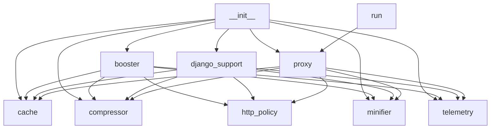

# Code Map

Generated with `python refresh_docs.py`.

## go_fast/__init__.py

## go_fast/booster.py

- `parse_asgi_headers` (line 16): Convert ASGI header tuples to normalized lower-case dict.
- `RocketBooster` (line 21): High-speed ASGI middleware combining caching, minification, and compression.
- `__init__` (line 24): Internal implementation.
- `attach` (line 47): Convenient one-line setup for FastAPI or Starlette apps.
- `__call__` (line 53): ASGI request handler routing HTTP requests through optimizer.
- `_handle_get` (line 78): Check cache and serve response immediately if valid.
- `_send_304` (line 116): Send HTTP 304 Not Modified.
- `_send_cached` (line 122): Send complete cached response to client.
- `_passthrough_and_cache` (line 145): Execute downstream app, capture response, minify, compress, and cache.
- `intercept_send` (line 160): Internal implementation.

## go_fast/cache.py

- `synchronized` (line 12): Serialize cache operations across worker threads.
- `CacheEntry` (line 23): Cached response item with metadata and expiration.
- `FastMemoryCache` (line 39): Thread-safe LRU in-memory cache supporting TTL and key invalidation.
- `guarded` (line 15): Hold the cache lock for the complete operation.
- `is_expired` (line 34): Check if entry has outlived its time to live.
- `__init__` (line 42): Internal implementation.
- `compute_etag` (line 52): Generate a fast ETag for binary payload.
- `make_key` (line 57): Generate unique cache key based on request parameters.
- `get` (line 63): Retrieve entry by key if valid and not expired.
- `set` (line 75): Insert or update a cache entry with LRU eviction.
- `delete` (line 105): Remove single entry by key.
- `invalidate_path_prefix` (line 114): Invalidate all cached items whose original path starts with prefix.
- `clear` (line 122): Clear all cached entries.
- `count` (line 128): Return count of active entries.

## go_fast/compressor.py

- `is_compressible` (line 30): Determine if content type and payload size qualify for compression.
- `choose_encoding` (line 38): Select the best compression algorithm supported by client.
- `compress_payload` (line 59): Compress bytes using chosen encoding.
- `ResponseCompressor` (line 70): Handles adaptive payload compression according to client headers.
- `__init__` (line 73): Internal implementation.
- `compress` (line 76): Compress content if eligible, returning compressed bytes and encoding.

## go_fast/django_support.py

- `DjangoRocketMiddleware` (line 13): WSGI-compatible Django middleware providing caching and compression.
- `__init__` (line 16): Internal implementation.
- `__call__` (line 23): Process incoming Django request with caching and compression.

## go_fast/http_policy.py

- `request_cacheable` (line 7): Exclude personalized, conditional and explicitly uncached requests.
- `response_cacheable` (line 15): Store only responses safe for a shared representation cache.
- `merge_vary` (line 23): Preserve existing negotiation fields while adding compression.

## go_fast/minifier.py

- `minify_html` (line 16): Safely collapse redundant whitespace and strip comments from HTML.
- `minify_css` (line 31): Minify CSS by stripping comments and unneeded spacing.
- `minify_json` (line 46): Serialize JSON without extraneous whitespace.
- `FastMinifier` (line 55): Dispatches payload to type-specific minifier.
- `protect` (line 19): Keep whitespace-sensitive HTML verbatim.
- `protect` (line 34): Keep quoted CSS values verbatim.
- `minify` (line 59): Minify text content based on its content-type.

## go_fast/proxy.py

- `SpeedProxyServer` (line 20): Universal reverse proxy that accelerates any target web server.
- `__init__` (line 23): Internal implementation.
- `get_client` (line 31): Return pooled async HTTP client for connection reuse.
- `set_target` (line 37): Update upstream target URL and reset cache.
- `handle_request` (line 42): Intercept, cache, optimize, and proxy incoming client request.
- `_check_cache` (line 61): Check cache and return 304 or cached content if valid.
- `_fetch_and_cache` (line 97): Fetch from origin server, minify, compress, and store in cache.
- `close` (line 152): Release upstream pooled connections on shutdown.

## go_fast/telemetry.py

- `RequestLog` (line 9): Record of an individual processed HTTP request.
- `TelemetryTracker` (line 21): Thread-safe statistics accumulator for the booster engine.
- `__init__` (line 24): Internal implementation.
- `record_request` (line 34): Record an incoming request and update aggregate statistics.
- `get_stats` (line 71): Return summary metrics for dashboard and monitoring.
- `reset` (line 96): Reset all tracked performance metrics.

## run.py

- `lifespan` (line 21): Close pooled upstream connections when the gateway stops.
- `serve_dashboard` (line 38): Serve the management and telemetry dashboard.
- `get_stats` (line 45): Return live telemetry metrics and cache status.
- `set_target` (line 54): Update target website URL for the accelerator.
- `clear_cache` (line 67): Flush in-memory cache and reset telemetry.
- `is_port_open` (line 74): Quickly check if a local port has an active listening server.
- `detect_local` (line 82): Scan common development ports for running applications.
- `proxy_gateway` (line 95): Proxy requests through the caching and optimization engine.
- `launch_browser` (line 100): Open user browser to the dashboard.
- `main` (line 105): Launch the local dashboard and acceleration gateway.

