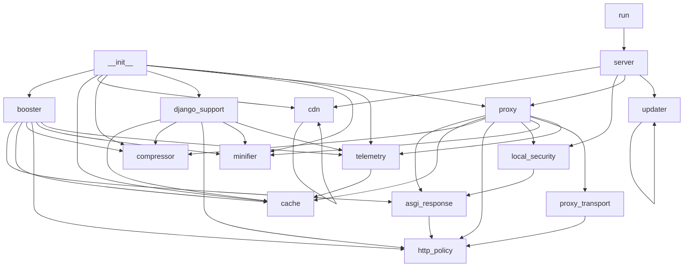

# Code Map

Generated with `python refresh_docs.py`.

## booster/__init__.py

## booster/asgi_response.py

- `parse_headers` (line 8): Combine repeated fields so restrictive cache directives cannot be hidden.
- `ASGIResponseOptimizer` (line 18): Capture one bounded public response and forward all other messages.
- `representation_headers` (line 70): Replace length, validators and negotiation fields after changing a body.
- `__init__` (line 21): Keep request state separate from the shared middleware instance.
- `__call__` (line 28): Forward streams and extensions immediately, optimizing a single body.
- `_optimized` (line 49): Minify and compress public bytes, preserving unrelated response fields.

## booster/booster.py

- `RocketBooster` (line 16): Accelerate public responses while leaving personalized traffic untouched.
- `__init__` (line 19): Initialize bounded caches or share the instance exposed by attach.
- `attach` (line 36): Register middleware and expose the cache actually serving the app.
- `cache_key` (line 42): Isolate representations by scheme, host, path and query.
- `__call__` (line 49): Bypass private requests and invalidate cached reads around mutations.
- `_handle_get` (line 71): Serve a public cached representation or its conditional response.
- `_send_304` (line 94): Send a public conditional response without a payload.
- `_send_cached` (line 101): Send cached content with validators matching the transformed bytes.
- `_passthrough_and_cache` (line 109): Optimize a bounded response while respecting ASGI streaming semantics.

## booster/cache.py

- `synchronized` (line 13): Serialize cache operations across worker threads.
- `CacheEntry` (line 24): Cached response item with metadata and expiration.
- `FastMemoryCache` (line 40): Thread-safe LRU in-memory cache supporting TTL and key invalidation.
- `guarded` (line 16): Hold the cache lock for the complete operation.
- `is_expired` (line 35): Check if entry has outlived its time to live.
- `__init__` (line 43): Initialize item and byte budgets with a monotonic default expiration.
- `compute_etag` (line 60): Generate a fast ETag for binary payload.
- `make_key` (line 65): Generate unique cache key based on request parameters.
- `get` (line 71): Retrieve entry by key if valid and not expired.
- `set` (line 83): Insert or update a cache entry with LRU eviction.
- `_insert_entry` (line 107): Insert one entry with LRU eviction under the caller's cache lock.
- `_entry_size` (line 120): Include response bodies and headers in the memory budget.
- `set_if_current` (line 125): Reject responses fetched before an invalidation or target change.
- `delete` (line 130): Remove single entry by key.
- `invalidate_path_prefix` (line 139): Invalidate all cached items whose original path starts with prefix.
- `clear` (line 148): Clear all cached entries.
- `count` (line 156): Return count of active entries.

## booster/cdn.py

- `CDNConfig` (line 14): Configuration for CDN automated cache synchronization.
- `CDNManager` (line 45): Zero-overhead multi-CDN cache purger and header generator.
- `from_env` (line 22): Auto-detect CDN credentials from environment variables.
- `__init__` (line 48): Internal implementation.
- `get_cdn_headers` (line 52): Return standardized edge caching headers compatible with all major CDNs.
- `purge_all` (line 59): Asynchronously purge edge cache across configured CDN provider.
- `_purge_cloudflare` (line 89): Purge Cloudflare Zone Cache via Client v4 API.
- `_purge_bunny` (line 99): Purge BunnyCDN Pull Zone Cache.
- `_purge_fastly` (line 106): Purge Fastly Service Cache.

## booster/compressor.py

- `is_compressible` (line 30): Determine if content type and payload size qualify for compression.
- `choose_encoding` (line 38): Select the best compression algorithm supported by client.
- `compress_payload` (line 59): Compress bytes using chosen encoding.
- `ResponseCompressor` (line 70): Handles adaptive payload compression according to client headers.
- `__init__` (line 73): Set the minimum payload size eligible for public-response compression.
- `compress` (line 77): Compress content if eligible, returning compressed bytes and encoding.

## booster/django_support.py

- `DjangoRocketMiddleware` (line 12): Cache only explicitly public, bounded and non-streaming Django responses.
- `__init__` (line 15): Initialize the downstream callable and bounded optimization services.
- `__call__` (line 23): Bypass personalized requests and invalidate derived reads around writes.
- `_cached_response` (line 45): Restore headers with a length matching the cached representation.
- `_store_response` (line 56): Cache only a public response and correct validators after minification.

## booster/http_policy.py

- `cache_directives` (line 7): Parse case-insensitive cache directive names without substring matches.
- `request_cacheable` (line 13): Exclude personalized, conditional and explicitly uncached requests.
- `response_cacheable` (line 24): Store only responses safe for a shared representation cache.
- `filtered_headers` (line 36): Remove hop-by-hop fields including fields nominated by Connection.
- `merge_vary` (line 44): Preserve existing negotiation fields while adding compression.

## booster/local_security.py

- `validate_target` (line 14): Reject credentials, malformed ports, special networks and gateway loops.
- `LocalAccessGuard` (line 38): Block remote clients, DNS rebinding and browser requests from other origins.
- `__init__` (line 41): Select management restrictions or the isolated gateway access policy.
- `__call__` (line 45): Validate raw host and peer before routing any HTTP request.
- `_error` (line 66): Return the precise failed local browser access boundary.
- `secure_send` (line 55): Make management responses private and prevent framing or sniffing.

## booster/minifier.py

- `minify_html` (line 9): Preserve HTML verbatim; regex rewriting can change markup and text meaning.
- `minify_css` (line 14): Preserve CSS verbatim; selectors and custom properties depend on whitespace.
- `minify_json` (line 19): Remove JSON whitespace without rounding numbers or rewriting string values.
- `FastMinifier` (line 28): Optimize UTF-8 JSON while preserving all other content byte for byte.
- `minify` (line 32): Remove only insignificant JSON whitespace from explicitly UTF-8 content.

## booster/proxy.py

- `RejectCookies` (line 25): Never retain upstream credentials in a shared connection pool.
- `SpeedProxyServer` (line 33): Accelerate public origin responses without retaining personalized bodies.
- `set_ok` (line 28): Reject every upstream cookie; clients manage their own cookie state.
- `__init__` (line 36): Initialize a trusted target and resource limits.
- `get_client` (line 46): Reuse connections without environment proxies or a shared cookie jar.
- `set_target` (line 55): Validate a new origin and invalidate pending and stored representations.
- `_key` (line 61): Keep scheme, host and encoded path representations separate.
- `handle_request` (line 67): Route requests and invalidate all derived reads around mutations.
- `_check_cache` (line 86): Serve a public representation with the same validators on miss and hit.
- `_fetch_and_cache` (line 102): Fetch one raw origin response with upload and buffering limits.
- `_prepare_response` (line 130): Transform only explicitly public responses and preserve repeated headers.
- `close` (line 149): Release upstream pooled connections on shutdown.

## booster/proxy_transport.py

- `BodyTooLarge` (line 15): Signal a request exceeding the gateway upload limit.
- `request_body` (line 19): Bound request buffering even when Content-Length is missing or forged.
- `outgoing_headers` (line 31): Prevent proxy identity spoofing and request unencoded upstream content.
- `upstream_body` (line 39): Buffer small raw responses and stream larger bodies with bounded memory.
- `stream_body` (line 62): Release the pooled connection on completion, cancellation or read failure.

## booster/server.py

- `lifespan` (line 26): Close pooled upstream connections when the gateway stops.
- `serve_dashboard` (line 46): Serve the management and telemetry dashboard.
- `get_stats` (line 53): Return live telemetry metrics and cache status.
- `check_update_api` (line 64): Force an active check for available updates.
- `apply_update_api` (line 71): Manually apply an available patch or report instructions.
- `set_target` (line 79): Update target website URL for the accelerator.
- `clear_cache` (line 92): Flush in-memory cache and reset telemetry.
- `is_port_open` (line 101): Quickly check if a local port has an active listening server.
- `detect_local` (line 109): Scan common development ports for running applications.
- `find_local_target` (line 114): Find a development server with concurrent bounded loopback probes.
- `gateway_redirect` (line 127): Keep old gateway links working on the isolated upstream origin.
- `proxy_gateway` (line 136): Proxy requests through the caching and optimization engine.
- `launch_browser` (line 141): Open user browser to the dashboard.
- `main` (line 146): Launch the local dashboard and acceleration gateway.
- `serve_local` (line 159): Run dashboard and gateway on separate origins with shared lifecycle.
- `stop_servers` (line 171): Stop both origins together on a terminal interrupt or termination.

## booster/telemetry.py

- `RequestLog` (line 11): Record of an individual processed HTTP request.
- `TelemetryTracker` (line 23): Thread-safe statistics accumulator for the booster engine.
- `__init__` (line 26): Initialize locked counters and a bounded redacted log collection.
- `record_request` (line 39): Record an incoming request and update aggregate statistics.
- `_append_log` (line 64): Append one redacted log while the caller holds the telemetry lock.
- `get_stats` (line 82): Return summary metrics for dashboard and monitoring.
- `reset` (line 108): Reset all tracked performance metrics.

## booster/updater.py

- `parse_version` (line 22): Parse a semantic version string into a (major, minor, patch) tuple.
- `classify_update` (line 35): Classify update level: 'none', 'patch', 'minor', or 'major'.
- `fetch_latest_release` (line 49): Query GitHub releases API for the latest released version.
- `apply_patch_update` (line 66): Safely apply a patch update in the background using pip.
- `check_for_updates` (line 78): Check for available updates with caching and auto-patch application.
- `_build_update_message` (line 115): Format a clear human-readable status message for the dashboard and CLI.

## go_fast/__init__.py

## go_fast/asgi_response.py

- `parse_headers` (line 8): Combine repeated fields so restrictive cache directives cannot be hidden.
- `ASGIResponseOptimizer` (line 18): Capture one bounded public response and forward all other messages.
- `representation_headers` (line 70): Replace length, validators and negotiation fields after changing a body.
- `__init__` (line 21): Keep request state separate from the shared middleware instance.
- `__call__` (line 28): Forward streams and extensions immediately, optimizing a single body.
- `_optimized` (line 49): Minify and compress public bytes, preserving unrelated response fields.

## go_fast/booster.py

- `RocketBooster` (line 16): Accelerate public responses while leaving personalized traffic untouched.
- `__init__` (line 19): Initialize bounded caches or share the instance exposed by attach.
- `attach` (line 36): Register middleware and expose the cache actually serving the app.
- `cache_key` (line 42): Isolate representations by scheme, host, path and query.
- `__call__` (line 49): Bypass private requests and invalidate cached reads around mutations.
- `_handle_get` (line 71): Serve a public cached representation or its conditional response.
- `_send_304` (line 94): Send a public conditional response without a payload.
- `_send_cached` (line 101): Send cached content with validators matching the transformed bytes.
- `_passthrough_and_cache` (line 109): Optimize a bounded response while respecting ASGI streaming semantics.

## go_fast/cache.py

- `synchronized` (line 13): Serialize cache operations across worker threads.
- `CacheEntry` (line 24): Cached response item with metadata and expiration.
- `FastMemoryCache` (line 40): Thread-safe LRU in-memory cache supporting TTL and key invalidation.
- `guarded` (line 16): Hold the cache lock for the complete operation.
- `is_expired` (line 35): Check if entry has outlived its time to live.
- `__init__` (line 43): Initialize item and byte budgets with a monotonic default expiration.
- `compute_etag` (line 60): Generate a fast ETag for binary payload.
- `make_key` (line 65): Generate unique cache key based on request parameters.
- `get` (line 71): Retrieve entry by key if valid and not expired.
- `set` (line 83): Insert or update a cache entry with LRU eviction.
- `_insert_entry` (line 107): Insert one entry with LRU eviction under the caller's cache lock.
- `_entry_size` (line 120): Include response bodies and headers in the memory budget.
- `set_if_current` (line 125): Reject responses fetched before an invalidation or target change.
- `delete` (line 130): Remove single entry by key.
- `invalidate_path_prefix` (line 139): Invalidate all cached items whose original path starts with prefix.
- `clear` (line 148): Clear all cached entries.
- `count` (line 156): Return count of active entries.

## go_fast/cdn.py

## go_fast/compressor.py

- `is_compressible` (line 30): Determine if content type and payload size qualify for compression.
- `choose_encoding` (line 38): Select the best compression algorithm supported by client.
- `compress_payload` (line 59): Compress bytes using chosen encoding.
- `ResponseCompressor` (line 70): Handles adaptive payload compression according to client headers.
- `__init__` (line 73): Set the minimum payload size eligible for public-response compression.
- `compress` (line 77): Compress content if eligible, returning compressed bytes and encoding.

## go_fast/django_support.py

- `DjangoRocketMiddleware` (line 12): Cache only explicitly public, bounded and non-streaming Django responses.
- `__init__` (line 15): Initialize the downstream callable and bounded optimization services.
- `__call__` (line 23): Bypass personalized requests and invalidate derived reads around writes.
- `_cached_response` (line 45): Restore headers with a length matching the cached representation.
- `_store_response` (line 56): Cache only a public response and correct validators after minification.

## go_fast/http_policy.py

- `cache_directives` (line 7): Parse case-insensitive cache directive names without substring matches.
- `request_cacheable` (line 13): Exclude personalized, conditional and explicitly uncached requests.
- `response_cacheable` (line 24): Store only responses safe for a shared representation cache.
- `filtered_headers` (line 36): Remove hop-by-hop fields including fields nominated by Connection.
- `merge_vary` (line 44): Preserve existing negotiation fields while adding compression.

## go_fast/local_security.py

- `validate_target` (line 14): Reject credentials, malformed ports, special networks and gateway loops.
- `LocalAccessGuard` (line 38): Block remote clients, DNS rebinding and browser requests from other origins.
- `__init__` (line 41): Select management restrictions or the isolated gateway access policy.
- `__call__` (line 45): Validate raw host and peer before routing any HTTP request.
- `_error` (line 66): Return the precise failed local browser access boundary.
- `secure_send` (line 55): Make management responses private and prevent framing or sniffing.

## go_fast/minifier.py

- `minify_html` (line 9): Preserve HTML verbatim; regex rewriting can change markup and text meaning.
- `minify_css` (line 14): Preserve CSS verbatim; selectors and custom properties depend on whitespace.
- `minify_json` (line 19): Remove JSON whitespace without rounding numbers or rewriting string values.
- `FastMinifier` (line 28): Optimize UTF-8 JSON while preserving all other content byte for byte.
- `minify` (line 32): Remove only insignificant JSON whitespace from explicitly UTF-8 content.

## go_fast/proxy.py

- `RejectCookies` (line 25): Never retain upstream credentials in a shared connection pool.
- `SpeedProxyServer` (line 33): Accelerate public origin responses without retaining personalized bodies.
- `set_ok` (line 28): Reject every upstream cookie; clients manage their own cookie state.
- `__init__` (line 36): Initialize a trusted target and resource limits.
- `get_client` (line 46): Reuse connections without environment proxies or a shared cookie jar.
- `set_target` (line 55): Validate a new origin and invalidate pending and stored representations.
- `_key` (line 61): Keep scheme, host and encoded path representations separate.
- `handle_request` (line 67): Route requests and invalidate all derived reads around mutations.
- `_check_cache` (line 86): Serve a public representation with the same validators on miss and hit.
- `_fetch_and_cache` (line 102): Fetch one raw origin response with upload and buffering limits.
- `_prepare_response` (line 130): Transform only explicitly public responses and preserve repeated headers.
- `close` (line 149): Release upstream pooled connections on shutdown.

## go_fast/proxy_transport.py

- `BodyTooLarge` (line 15): Signal a request exceeding the gateway upload limit.
- `request_body` (line 19): Bound request buffering even when Content-Length is missing or forged.
- `outgoing_headers` (line 31): Prevent proxy identity spoofing and request unencoded upstream content.
- `upstream_body` (line 39): Buffer small raw responses and stream larger bodies with bounded memory.
- `stream_body` (line 62): Release the pooled connection on completion, cancellation or read failure.

## go_fast/server.py

- `lifespan` (line 23): Close pooled upstream connections when the gateway stops.
- `serve_dashboard` (line 43): Serve the management and telemetry dashboard.
- `get_stats` (line 50): Return live telemetry metrics and cache status.
- `set_target` (line 59): Update target website URL for the accelerator.
- `clear_cache` (line 72): Flush in-memory cache and reset telemetry.
- `is_port_open` (line 79): Quickly check if a local port has an active listening server.
- `detect_local` (line 87): Scan common development ports for running applications.
- `find_local_target` (line 92): Find a development server with concurrent bounded loopback probes.
- `gateway_redirect` (line 105): Keep old gateway links working on the isolated upstream origin.
- `proxy_gateway` (line 114): Proxy requests through the caching and optimization engine.
- `launch_browser` (line 119): Open user browser to the dashboard.
- `main` (line 124): Launch the local dashboard and acceleration gateway.
- `serve_local` (line 137): Run dashboard and gateway on separate origins with shared lifecycle.
- `stop_servers` (line 149): Stop both origins together on a terminal interrupt or termination.

## go_fast/telemetry.py

- `RequestLog` (line 11): Record of an individual processed HTTP request.
- `TelemetryTracker` (line 23): Thread-safe statistics accumulator for the booster engine.
- `__init__` (line 26): Initialize locked counters and a bounded redacted log collection.
- `record_request` (line 39): Record an incoming request and update aggregate statistics.
- `_append_log` (line 64): Append one redacted log while the caller holds the telemetry lock.
- `get_stats` (line 82): Return summary metrics for dashboard and monitoring.
- `reset` (line 108): Reset all tracked performance metrics.

## go_fast/updater.py

## run.py

## setup_plugin.py

- `environment_python` (line 16): Locate the plugin interpreter independently of the current directory.
- `run_checked` (line 21): Run an exact argument vector and surface installation or startup failures.
- `setup_environment` (line 26): Install dependencies only on first use or when project requirements change.
- `main` (line 43): Prepare the plugin, optionally check setup, and open the local dashboard.

