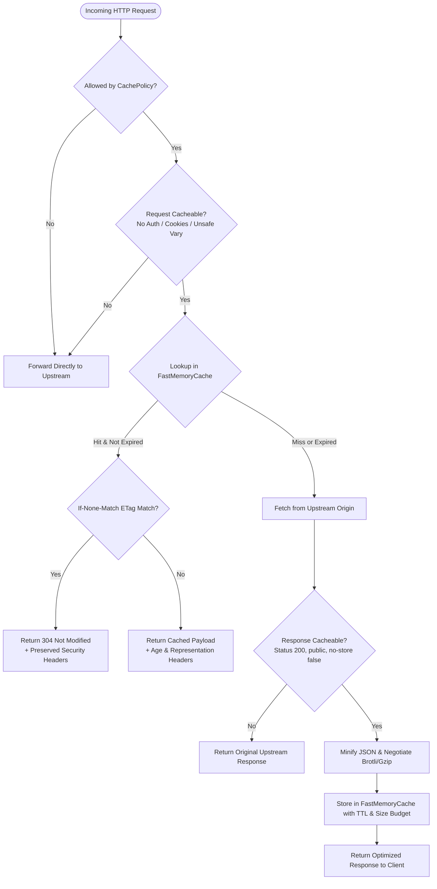
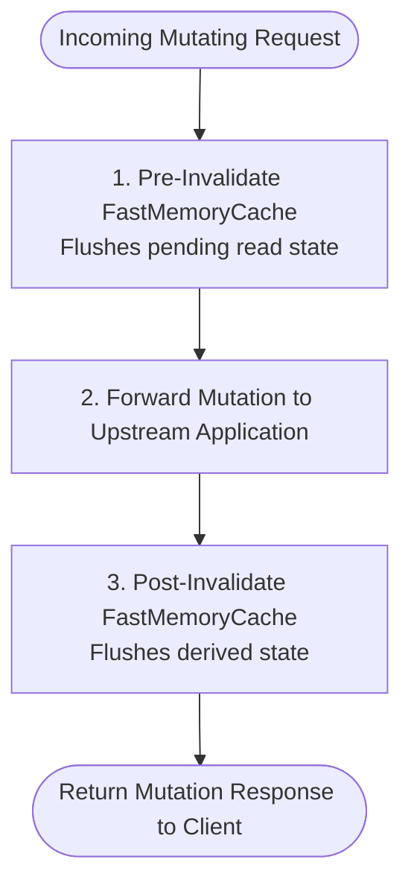
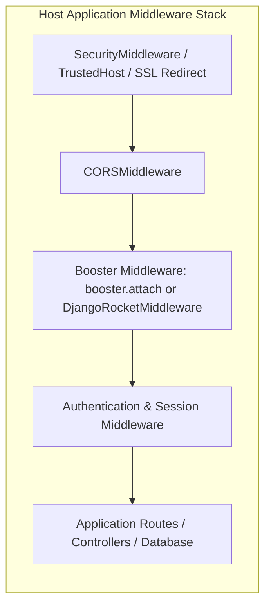

# Booster: Complete Features and System Architecture Reference

> **Document Version:** 1.0.0  
> **Target Audience:** Developers, System Architects, and Autonomous Agents.  
> **Related Guides:** [INTEGRATION.md](INTEGRATION.md) | [USE_CASES.md](USE_CASES.md) | [BUILDS.md](BUILDS.md) | [COMMANDS.md](../COMMANDS.md) | [CODEMAP.md](../CODEMAP.md)

---

## 1. Executive Summary & Philosophy

**Booster** is a unified, ultra-fast caching, conservative minification, and adaptive compression engine engineered for Python (ASGI / FastAPI / Starlette, WSGI / Django) and Node.js (`booster-node`). It operates either as an embedded, single-line middleware or as a standalone local reverse proxy gateway with an interactive telemetry dashboard.

### Core Design Philosophy
1. **Zero External Infrastructure Required:** Eliminates dependencies on external caching services such as Redis, Memcached, or Varnish for local node acceleration, saving cloud cost and network round-trip overhead.
2. **Conservative HTTP Caching Guards:** Implements RFC 9111 privacy/freshness guards and bypasses recognized credentials, session scope and mutating requests. Consuming apps must classify other personalized responses correctly; reviewed cases do not prove every HTTP/framework combination safe.
3. **Bounded In-Memory Footprint:** Operates within strictly bounded process RAM budgets (`max_cache_bytes`) with monotonic LRU (Least Recently Used) eviction to prevent memory bloat or out-of-memory crashes.
4. **Separation of Concerns:** Booster only handles reusable response acceleration. It does not replace application authentication, authorization, database indexing, frontend asset bundling, or TLS termination.

---

## 2. Technology Stack & Ecosystem Compatibility Matrix

| Category | Supported Technologies | Integration Mode |
| :--- | :--- | :--- |
| **Python Ecosystem** | Python 3.10+, 3.11, 3.12, 3.13, 3.14<br>• **FastAPI**<br>• **Starlette**<br>• **Django** (WSGI)<br>• Any ASGI/WSGI web app | Native embedded middleware (`booster.attach` or `DjangoRocketMiddleware`) |
| **Node.js Ecosystem** | Node.js 18+, 20+, 22+, 24+<br>• **Express.js**<br>• **Connect**<br>• Native HTTP servers | Native embedded middleware (`booster-node`) |
| **Universal Upstream (Any Tech)** | **PHP / Laravel / WordPress**, **Ruby on Rails**, **Go**, **Java / Spring**, **ASP.NET Core**, **Rust** | Standalone Reverse Proxy Gateway (`SpeedProxyServer` on port `5051`) with GUI (`5050`) |
| **Compression Codecs** | • **Brotli (`br`)**: Highest compression ratio (up to 85% payload savings)<br>• **Gzip (`gzip`)**: Zero-dependency standard library codec<br>• **Identity**: Client-negotiated uncompressed passthrough | Automatic negotiation via client `Accept-Encoding` header |
| **Edge & CDN Networks** | • **Cloudflare** (API v4)<br>• **BunnyCDN** (Pull Zone API)<br>• **Fastly** (Service Cache API) | Standardized `CDN-Cache-Control` / `Surrogate-Control` headers + asynchronous purge APIs |
| **Standard Protocols** | HTTP/1.1, HTTP/2, RFC 9111 (HTTP Caching), RFC 9110 (HTTP Semantics) | ETag generation, `If-None-Match` 304 validation, Hop-by-Hop stripping |

---

## 3. Division of Responsibilities: What Booster Does vs What Your Project Does

> **Key Takeaway for Developers & Agents:** Booster handles roughly 50% of your performance and caching pipeline out of the box. Knowing exactly where Booster's boundary ends ensures you don't write redundant caching code or neglect core application security.

| Functional Area | ⚡ What Booster Handles Automatically (Done for You) | 🛠️ What Your Application Project Still Must Do |
| :--- | :--- | :--- |
| **Response Caching** | • In-memory microsecond LRU cache (`FastMemoryCache`)<br>• Monotonic TTL management<br>• Bounded memory limits (`max_cache_bytes`)<br>• Automatic LRU entry eviction | • Designate public asset paths via `CachePolicy`<br>• Ensure static routes declare `Cache-Control: public` |
| **Security & Privacy** | • Automatic bypass for cookies and `Authorization` headers<br>• Bypass for `no-store`, `private`, `no-cache`<br>• Stripping hop-by-hop headers (`Connection`, `Keep-Alive`)<br>• DNS rebinding protection on dashboard (`LocalAccessGuard`) | • User authentication (JWT, sessions, OAuth)<br>• Route-level authorization & role checks<br>• HTTPS / TLS certificate termination<br>• Rate limiting and anti-DDoS filters |
| **Payload Optimization** | • Lossless UTF-8 JSON minification (`FastMinifier`)<br>• Client-negotiated Brotli and Gzip compression<br>• Compression threshold guards (skips tiny bodies) | • Frontend bundling (Vite, Webpack, esbuild)<br>• CSS/JS tree-shaking and asset minification<br>• Image optimization (WebP/AVIF generation, sizing) |
| **Cache Freshness & Mutations** | • Automatic pre- and post-write invalidation on `POST`, `PUT`, `DELETE`, `PATCH`<br>• Path-prefix invalidation (`invalidate_path_prefix`) | • Adding version hashes/query params to updated static assets (e.g. `style.css?v=2`)<br>• Multi-process invalidation if using many independent workers |
| **HTTP Validation** | • Fast binary SHA-256 ETag calculation<br>• Automatic `304 Not Modified` conditional response generation | • Determining business logic and database queries on cache miss |
| **CDN & Edge Delivery** | • Emitting `CDN-Cache-Control` & `Surrogate-Control` headers<br>• Automated background edge purges for Cloudflare, Bunny, Fastly | • Configuring your domain's DNS to point to your CDN<br>• Setting up CDN API tokens in environment variables |
| **Monitoring & Telemetry** | • Process-level hit ratio, total requests, bandwidth savings counters<br>• Local web dashboard GUI on port 5050 | • Distributed application tracing (e.g., OpenTelemetry, Prometheus, Datadog) |

---

## 4. Complete Feature Catalogue (Facilities Provided)

Booster provides seven core architectural facilities:

### 2.1 Microsecond In-Memory LRU Cache (`FastMemoryCache`)
- **Monotonic TTL Expiration:** Cache entries expire based on high-resolution monotonic timestamps (`time.monotonic()`), remaining immune to system clock skews and NTP adjustments.
- **Dual Budget Limits:** Bounded by total item count (`max_size`) and configurable memory budget (`max_cache_bytes`, defaults to 64 MiB; can be tuned e.g. 8 MiB for tight workers).
- **LRU Eviction Policy:** Transparent eviction of least recently accessed entries whenever size or memory ceilings are reached.
- **Fast Binary ETag & 304 Not Modified:** Generates SHA-256 binary entity tags for cached responses. Automatically processes `If-None-Match` requests and serves standard `304 Not Modified` headers without re-transmitting response bodies.
- **Runtime-Specific Coordination:** Python cache operations use internal reentrant locks; Node uses process/event-loop-local maps and mutation generations. Workers do not share invalidation automatically.

### 2.2 Strict Privacy & HTTP RFC 9111 Boundaries (`http_policy.py`)
- **Uncompromising Private Data Protection:** Automatically bypasses shared caching if:
  - The request contains `Authorization` headers or cookies.
  - The response declares `Cache-Control: private`, `no-store`, `no-cache`, or `no-transform`.
  - The response contains session, auth, or `Set-Cookie` headers.
  - The request includes conditional headers (`If-Match`, `If-Modified-Since`) not matching valid stored representations.
- **Hop-by-Hop Header Sanitization:** Automatically strips connection-specific headers (`Connection`, `Keep-Alive`, `Proxy-Authenticate`, `Transfer-Encoding`, etc.) to preserve HTTP gateway integrity.
- **Origin Freshness Capping:** Honors origin `max-age` and `s-maxage` directives. A configured TTL will never serve a response past the maximum age declared by the upstream origin.
- **Path Policy Routing (`CachePolicy`):** Granular path control via `include_paths` and `exclude_paths`. Exact path matching and slash-terminated subtrees (e.g., `/static/`) are strictly enforced; exclusions always override inclusions.

### 2.3 Automatic Mutation Invalidation
- **State-Safety Around Writes:** Any mutating HTTP method (`POST`, `PUT`, `DELETE`, `PATCH`) invalidates derived cached reads.
- **Dual Invalidation:** Invalidation occurs *before* forwarding the mutation to upstream (to avoid serving stale reads during long transactions) and *after* completion (to clear data altered by the write).
- **Path-Prefix Invalidation:** Supports surgical invalidation of subtrees (`invalidate_path_prefix`) or full cache purge when cross-route dependencies exist.

### 2.4 Adaptive Content Compression (`ResponseCompressor`)
- **Client Encoding Negotiation:** Automatically inspects client `Accept-Encoding` headers and negotiates the optimal algorithm:
  1. **Brotli (`br`):** Highest compression ratio (up to 85% reduction for text); loaded lazily via optional `[brotli]` extra.
  2. **Gzip (`gzip`):** Standard, ubiquitous compression using Python standard library `gzip` (zero-dependency).
  3. **Identity (Uncompressed):** Fallback when the client supports neither.
- **MIME Eligibility & Thresholds:** Only compresses textual MIME types (`text/*`, `application/json`, `application/javascript`, `image/svg+xml`, etc.). Small payloads below a configured byte threshold (e.g. 256 bytes) pass through uncompressed to eliminate CPU overhead.
- **Vary Header Preservation:** Accurately attaches or merges `Vary: Accept-Encoding` to prevent intermediate proxies from poisoning client caches.

### 2.5 Conservative & Safe Minification (`FastMinifier`)
- **Lossless JSON Minification:** Safely removes insignificant whitespace from UTF-8 JSON payloads without rounding numbers, altering string literals, or corrupting escaped sequences.
- **HTML & CSS Integrity Preservation:** Intentionally leaves HTML and CSS whitespace intact by default. Aggressive regex-based HTML/CSS minifiers frequently break inline templates, preformatted blocks, and CSS custom properties; Booster prioritizes rendering stability.

### 2.6 Multi-CDN Edge Synchronization (`CDNManager`)
- **Standardized Edge Headers:** Automatically emits `CDN-Cache-Control` and `Surrogate-Control` headers for eligible public static assets.
- **Multi-Provider Purge Integration:** Built-in asynchronous cache purge clients for:
  - **Cloudflare** (via Cloudflare Client API v4).
  - **BunnyCDN** (via Bunny Pull Zone Cache API).
  - **Fastly** (via Fastly Service Cache API).
- **Environment Auto-Detection:** Automatically loads CDN credentials from environment variables (`CLOUDFLARE_API_KEY`, `BUNNY_API_KEY`, `FASTLY_API_KEY`).

### 2.7 Standalone Proxy Gateway & Telemetry Dashboard (`booster[server]`)
- **Zero-Code Reverse Proxy Gateway:** Runs on port `5051` as a standalone reverse proxy (`SpeedProxyServer`), instantly accelerating any upstream web app (Django, Express, Flask, Rails, PHP/Laravel, Go).
- **Interactive Real-Time GUI Dashboard:** Runs on port `5050` (`booster/server.py`), presenting live telemetry metrics:
  - Request counters (total, cached hits, missed, bypassed).
  - Bandwidth savings (raw bytes saved via compression/cache).
  - Real-time cache memory usage and active entry count.
  - Redacted recent request activity logs.
- **Local Access Security Guard (`LocalAccessGuard`):** Blocks DNS rebinding attacks, enforces loopback access, and secures management endpoints using the `X-Booster-Admin` header.
- **Automatic Dev Port Scanner:** Probes common development ports (8000, 3000, 5000, 8080) on loopback to detect running web servers with one click.
- **Smart Update Daemon:** Checks GitHub Releases for updates; features a quiet monthly background heartbeat daemon (`updater.py`) for headless servers without intrusive auto-installs.

### 2.8 Shared Invalidation Between Workers (`invalidation.py`)
- **The Stale Window It Closes:** Every worker owns its own RAM cache, so a write that reaches one worker leaves the other workers serving an old copy until their entry expires.
- **Opt-In Bus (`InvalidationBus`):** The worker that handled the write publishes the invalidation scope; every other worker applies it before it serves its next request. Without a bus the documented process-local behaviour is unchanged.
- **File-Backed Bus (`FileInvalidationBus`):** Standard-library only, for workers on one host. Python and Node share generation-tagged JSON records and a bounded directory lock. Rotation forces existing readers to clear even after the journal refills. Peer invalidations retire in-flight Node capture contexts. See `INTEGRATION.md` for coordinated upgrades, local-filesystem limits and lock recovery.
- **Scope Fidelity:** The published notice matches the local scope exactly: a prefix notice for surgical invalidation, a full-clear notice otherwise.
- **Proven With Real Processes:** `tests/test_shared_invalidation.py` runs two worker processes and proves the peer returns fresh bytes after the other worker wrote, and that the process-local boundary is unchanged when no bus is configured.

### 2.9 Declarative Site Configuration (`site_config.py`)
- **One JSON File:** `SiteConfig.from_file()` turns `booster.json` into the route policy, the TTL, the byte budget, the compression and minification switches and the optional shared invalidation file.
- **Fail-Fast Validation:** An unknown key, a relative route prefix or a non-positive limit is rejected with a clear error instead of being ignored.
- **Standard Library Only:** The module adds no runtime dependency, so core stays installable without extras.
- **Scaffolding Command:** `booster init --config` writes the matching `booster.json` next to the generated adapter, and the Node engine offers the same flow through `npx booster-node init`.

### 2.10 Operator Visibility: Bypass Reasons (`bypass.py`)
- **Why Was This Not Cached:** Every response that is not stored is counted under a fixed reason name: `credentialed_request`, `personalized_scope`, `route_not_selected`, `response_not_public`, `request_directive`, `method_not_read`, `streamed_response`, `body_too_large`, `already_encoded` or `stored`.
- **No Request Data:** The counters hold reason names only. No cookie, token, path, query or payload is recorded, so the snapshot can be shown to an operator or embedded in a host dashboard.
- **Same In Node:** `middleware.status()` returns the same snapshot and the same reason counters.

---

## 5. System Architecture & Workflows

### 3.1 Request Lifecycle: Cache Read Flow (GET/HEAD)



### 3.2 Mutation Lifecycle: Invalidation Flow (POST/PUT/DELETE/PATCH)



### 3.3 Recommended Middleware Layering Order

To preserve security, authentication, and CORS invariants, Booster must be registered inside outer security and host-validation layers:


*Why this matters:* When Booster serves a cached public asset from RAM, outer layers (`M1`, `M2`) still execute, ensuring security headers and CORS policies are faithfully applied to every hit.

---

## 6. Module Map & Source Code Directory Structure

```text
booster/
├── __init__.py           # Package entry point; lazy imports for optional server/cdn/brotli
├── asgi_response.py      # ASGIResponseOptimizer: captures, minifies, and compresses ASGI responses
├── booster.py            # RocketBooster: ASGI middleware and lifecycle orchestrator
├── cache.py              # FastMemoryCache: LRU thread-safe cache, ETag calculation, byte budgets
├── cache_policy.py       # CachePolicy: path prefix and exclusion rules
├── cdn.py                # CDNManager: multi-CDN purge and CDN-Cache-Control header management
├── cli.py                # Command-line interface launcher
├── compressor.py         # ResponseCompressor: Brotli and Gzip adaptive compression
├── django_support.py     # DjangoRocketMiddleware: WSGI/Django cache adapter
├── http_policy.py        # RFC 9111 HTTP compliance, privacy rules, and header filtering
├── invalidation.py       # InvalidationBus: shared notices between worker processes
├── bypass.py             # BypassTracker: why a response was not stored (no request data)
├── site_config.py        # SiteConfig: declarative JSON site configuration
├── initializer.py        # Adapter scaffolding for `booster init`
├── local_security.py     # LocalAccessGuard: DNS rebinding defense and X-Booster-Admin auth
├── minifier.py           # FastMinifier: conservative JSON minification
├── proxy.py              # SpeedProxyServer: standalone reverse proxy engine
├── proxy_transport.py    # Gateway streaming, upload bounds, and pooled upstream connections
├── server.py             # Management telemetry dashboard (port 5050) & gateway runner (5051)
├── telemetry.py          # TelemetryTracker: thread-safe hit/miss/bandwidth metrics
└── updater.py            # Update checking against GitHub Releases and monthly heartbeat daemon

booster-node/             # Node.js Express/Connect implementation
├── src/*.ts              # Canonical Node cache, compression, policy and middleware
├── dist/                 # Generated runtime and declarations (ignored; packaged)
├── test/                 # Test suites for Node.js engine
└── package.json          # Node package manifest

docs/                     # Specialized Technical Guides
├── BUILDS.md             # Package build bundle, verification, and promotion
├── FEATURES_AND_ARCHITECTURE.md # (This file) Complete reference & architecture
├── INTEGRATION.md        # Step-by-step framework integration and review guide
├── PLUGIN_RECIPE.md      # Copy-ready recipe for embedding Booster in a host project
├── CONFORMANCE_CHECKLIST.md # Copy-paste privacy and correctness tests for a host
├── NEXT_STEPS.md         # Priority handoff tasks for next agents
└── USE_CASES.md          # Workload-based suitability and decision matrix

plans/                    # Multi-language roadmap and design blueprints
├── ROADMAP_MULTI_LANGUAGE.md # Strategy across Node, Go, and Rust
├── GO_BOOSTER_PLAN.md        # Phase 2 Go implementation design
└── RUST_BOOSTER_PLAN.md      # Phase 3 Rust high-throughput engine design

scripts/                  # Distribution, bundle packaging, and CI verification
├── build_bundle.py       # SHA-256 verified package bundling script
└── promote_demo.py       # Controlled release branch promotion script
```

---

## 7. Deployment & Integration Patterns

### 7.1 Embedded ASGI (FastAPI / Starlette)
```python
import booster
from fastapi import FastAPI

app = FastAPI()

# Single-line attachment with custom policy
engine = booster.attach(
    app,
    cache_policy=booster.CachePolicy(
        include_paths=("/static/", "/public/"),
        exclude_paths=("/static/uploads/",),
    ),
    enable_minification=True,
    enable_compression=True,
    cache_ttl=300,                  # 5 minutes RAM TTL
    max_cache_bytes=32 * 1024 * 1024 # 32 MiB RAM budget
)
```

### 7.2 Embedded Django (WSGI)
In `settings.py`:
```python
MIDDLEWARE = [
    'django.middleware.security.SecurityMiddleware',
    'booster.DjangoRocketMiddleware',  # Place after security, before auth/sessions
    'django.contrib.sessions.middleware.SessionMiddleware',
    # ...
]

BOOSTER_CONFIG = {
    'CACHE_TTL': 300,
    'MAX_CACHE_BYTES': 32 * 1024 * 1024,
    'ENABLE_COMPRESSION': True,
}
```

### 7.3 Embedded Node.js / Express
```typescript
import express from 'express';
import { booster } from 'booster-node';

const app = express();
app.use(booster({
    ttl: 300,
    maxCacheBytes: 32 * 1024 * 1024,
}));
```

Node responses require explicit `Cache-Control: public`; cookies/auth bypass
even static-looking paths. The host must declare public policy at the origin.
Node development uses TypeScript only; `npm run build --prefix booster-node`
generates the packaged runtime. See [the recent review](REVIEW_2026-10-15.md).

### 7.4 Standalone Proxy Gateway
Accelerate any legacy or external upstream service without code changes:
```bash
# Starts proxy gateway on port 5051 and dashboard on port 5050
booster --target http://127.0.0.1:8000
```

---

## 8. Operational Boundaries & Golden Rules for Agents

When integrating or maintaining Booster, all agents must adhere to the following principles:

1. **Never Cache Personalized HTML:** Never cache responses containing user names, account IDs, session tokens, or CSRF tokens. Public page caching is valid only when every visitor receives the exact same representation.
2. **Per-Process Memory Budgets:** The RAM cache lives inside the running process. In multi-worker deployments (e.g. Gunicorn with multiple Uvicorn workers), each worker maintains an independent cache. Pass one shared invalidation bus (`FileInvalidationBus`) when the workers share a host and must see each other's writes; otherwise exclude mutable routes from the cache.
3. **One Compression Owner:** If upstream or a CDN reverse proxy already performs Gzip/Brotli compression, disable Booster's compression (`enable_compression=False`) to avoid duplicate CPU work.
4. **Preserve Range & Stream Requests:** Booster deliberately bypasses media streaming and HTTP 206 Partial Content requests; never attempt to force large audio/video streams into RAM cache.
5. **Conservative Minification:** Do not replace `FastMinifier` with naive regular-expression string replacers on HTML/CSS; whitespace and comments can carry syntax meaning in modern web templates.

---

## 9. Fast-Track 3-Step Project Acceleration Playbook

Follow these three steps to integrate Booster into any new or existing project and cut page delivery times dramatically:

### Step 1: Install & Pin Booster
Add the pinned commit or built distribution into your host project's requirements:
```bash
pip install "booster @ git+https://github.com/Gaazi/booster.git@<REVIEWED_COMMIT>"
booster init --path . --include /static/ --exclude /media/ --config
```
The command writes a ready-to-edit `booster_plugin.py` (and the matching
`booster.json` with `--config`) into the host project. Node projects use
`npm install github:Gaazi/booster-node#<REVIEWED_COMMIT>` and
`npx booster-node init`.

### Step 2: Attach Middleware with Public Route Scope
Wrap your app with `booster.attach()`, scoping cache admission to public static files (`/static/`) and unauthenticated public GET endpoints:
```python
import booster

booster.attach(
    app,
    cache_policy=booster.CachePolicy(
        include_paths=("/static/", "/api/public/"),
        exclude_paths=("/api/public/live-status",),
    ),
    cache_ttl=300,
    max_cache_bytes=16 * 1024 * 1024,
)
```

### Step 3: Verify and Measure
Run your integration tests:
1. Confirm that `/static/style.css` returns an `ETag` and responds with `304 Not Modified` on re-request.
2. Confirm that logged-in responses (`/dashboard`, `/profile`) carry `Cache-Control: private` or cookies and pass through untouched without any caching.
3. Check CPU and memory usage using `engine.get_status()` to ensure memory usage stays strictly within your byte allocation.
4. Run the [conformance checklist](CONFORMANCE_CHECKLIST.md) in the host project's own test suite, and read `metrics["bypass_reasons"]` to confirm that every expected route is cached for the right reason.
