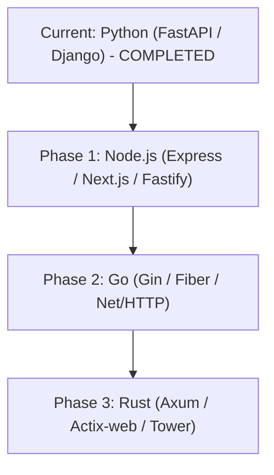

# 🌐 Multi-Language Booster Roadmap (Node.js, Go, Rust)

> **Vision:** Extend `booster` to the three most prominent web and systems languages (**Node.js**, **Go**, and **Rust**) using independent, zero-bloat, drop-in middleware modules while keeping the core clean and lightning fast.

---

## 🏛️ Core Architectural Principles

1. **Zero-Bloat Rule (کوئی فالتو بوجھ نہیں):**
   - Each language ecosystem remains an independent, lightweight standalone package.
   - Python users install only Python dependencies (`pip install booster`).
   - Node.js users install only npm dependencies (`npm install @booster/node`).
   - Go and Rust users pull native modules via `go get` and `cargo add`.
   - Never bundle cross-compilers or alien runtimes into another language's package.

2. **Unified Feature Matrix (یکساں فیچرز):**
   Across all three languages, `booster` provides identical high-performance superpowers:
   - **RAM In-Memory Cache (LRU + TTL):** Sub-millisecond response latency.
   - **Adaptive Brotli & Gzip Compression:** Dynamic payload reduction up to 85%.
   - **On-the-fly Minification:** HTML, CSS, JavaScript, and JSON whitespace stripping.
   - **HTTP 304 & ETag Engine:** Zero-byte transfers for repeat requests.
   - **Smart Invalidation:** Automatic purge on mutating methods (`POST`, `PUT`, `DELETE`).
   - **Live Telemetry:** Request tracking, bandwidth savings, and cache hit metrics.

3. **Consistent One-Line Developer Experience:**
   - Always 1-line activation regardless of language:
     - **Python (FastAPI):** `booster.attach(app)`
     - **Node.js (Express):** `app.use(booster())`
     - **Go (Gin):** `r.Use(booster.Rocket())`
     - **Rust (Axum):** `.layer(booster::RocketLayer::new())`

---

## 🗺️ Phased Implementation Plan

| Phase | Language | Primary Ecosystem | Target Release | Priority |
| :--- | :--- | :--- | :--- | :--- |
| **Phase 1** | **Node.js** (JS/TS) | Express, Next.js, Fastify | Q1 | 🥇 High |
| **Phase 2** | **Go** (Golang) | Gin, Fiber, Chi, Net/HTTP | Q2 | 🥈 Medium |
| **Phase 3** | **Rust** | Axum, Actix-web, Tower | Q3 | 🥉 Advanced |

---

## 📁 Detailed Language Plans
- [Node.js Plan](file:///d:/Projects/booster/plans/NODEJS_BOOSTER_PLAN.md)
- [Go Plan](file:///d:/Projects/booster/plans/GO_BOOSTER_PLAN.md)
- [Rust Plan](file:///d:/Projects/booster/plans/RUST_BOOSTER_PLAN.md)
