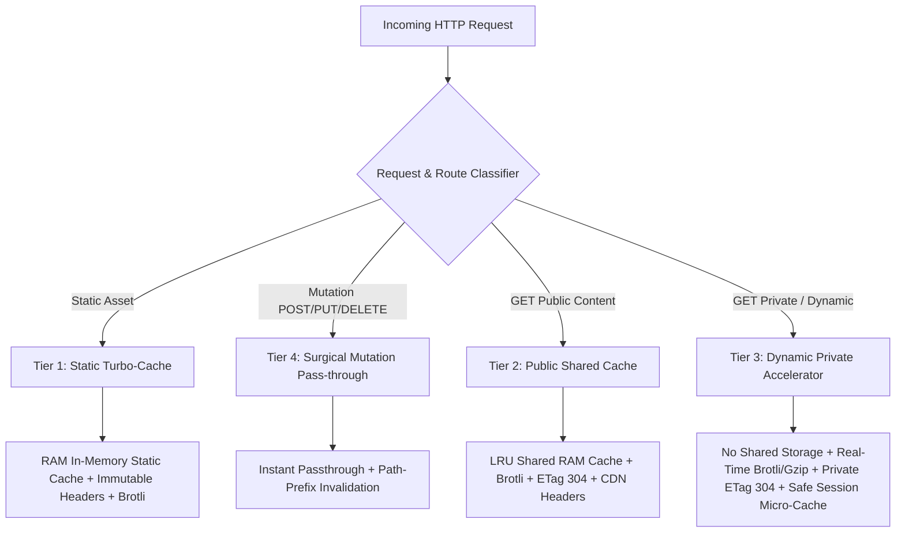

# Universal Smart Booster Implementation Plan

**Goal:** Transform `booster` (Python) and `booster-node` (Node.js) from a simple public-only cache into a universal, zero-config web accelerator that safely accelerates ANY web project (including personalized, private, or real-time applications like `Invite`) with 0% data leakage risk and maximum performance.

---

## 1. Architectural Analysis & Problem Identification

### The Problem in Current Booster:
1. **One-Dimensional (Shared Cache Only):** Current Booster only accelerates responses marked `Cache-Control: public` without cookies/auth. For dynamic, authenticated, or personalized apps (e.g. `Invite`, dashboards, e-commerce checkouts), Booster completely bypasses the request, offering 0% speed benefit while adding middleware wrapping overhead.
2. **All-or-Nothing Approach:** When a response is private, Booster skips compression, minification, and static optimization entirely.
3. **Blunt Mutation Invalidation:** Every `POST`/`PUT`/`DELETE` calls `cache.clear()`, wiping the entire server cache even for unrelated routes.
4. **No-op Minifiers:** HTML and CSS minification in Python currently return verbatim strings.
5. **Node.js Safety Vulnerability:** `booster-node` currently caches responses without checking `Cache-Control` or cookies, risking cross-session data leakage on personalized apps.

---

## 2. Proposed Architecture: The 4-Tier Smart Adaptive Engine

### Tier 1: Static Asset Turbo-Cache
- **Detection:** Checks route prefix (`/static/`, `/assets/`, `/public/`) or extension (`.css`, `.js`, `.woff2`, `.woff`, `.ttf`, `.svg`, `.png`, `.jpg`, `.ico`, `.webp`).
- **Behavior:** Completely immune to cookie/auth checks (static assets never contain user data). Cached in RAM for ultra-fast, zero-disk-I/O delivery with `Cache-Control: public, max-age=31536000, immutable` and Brotli compression.

### Tier 2: Public Shared Cache (Existing Enhanced)
- **Behavior:** For truly public, non-authenticated pages (blogs, catalog, docs). Cached in LRU memory, served with fast 304 checks, CDN headers, and automatic TTL.

### Tier 3: Dynamic & Private Accelerator (New for Apps like `Invite`)
- **Safety Guarantee:** NEVER stored in the shared cache. Zero risk of guest data mixing or session leakage.
- **Acceleration Vectors:**
  1. **Adaptive Streaming Brotli / Gzip:** Compresses dynamic HTML on-the-fly, reducing transfer size by 40-70% for mobile clients.
  2. **Private ETag & 304 Not Modified:** Generates dynamic ETags; returns instant 304 on re-validation without body transmission.
  3. **Safe Session Micro-Cache:** Optional 1-2 second deduplication per session/cookie to absorb rapid double-clicks without hitting heavy DB logic.

### Tier 4: Surgical Mutation Handling
- **Zero Latency:** Instant passthrough of `POST`, `PUT`, `DELETE`, `PATCH` without lock bottlenecks.
- **Surgical Invalidation:** Instead of flushing the entire site cache with `clear()`, uses `invalidate_path_prefix(path)` to only clear related caches (e.g. updating `/i/wedding/rsvp` only purges `/i/wedding`).

---

## 3. Implementation Steps

### Step 1: Text & Markup Minifiers Enhancement
- **File:** `booster/minifier.py`
- Implement safe regex-based HTML minification (stripping comments outside IE conditionals and collapsible tag whitespace outside `<pre>`, `<code>`, `<script>`, `<textarea>`).
- Implement safe CSS minification (stripping comments and redundant spacing).

### Step 2: Smart Classifier & Private Accelerator in ASGI / Python
- **Files:** `booster/booster.py`, `booster/asgi_response.py`
- Add route classification logic (`is_static_asset`, `is_private_request`).
- Enhance `ASGIResponseOptimizer` to apply on-the-fly minification and compression to dynamic/private responses without caching in the shared dictionary.
- Update mutation handler to use surgical `invalidate_path_prefix`.

### Step 3: Django Adapter Enhancement
- **File:** `booster/django_support.py`
- Apply the same 4-tier logic to Django middleware.

### Step 4: Node.js Security & Smart Adaptive Engine
- **Files:** `booster-node/src/index.js`, `cache.js`, `minifier.js`
- Fix cache leakage bug: verify response headers and cookies before shared caching.
- Add static turbo-cache and private on-the-fly compression.

### Step 5: Verification & Comprehensive Test Suites
- Retain 100% pass rate on all 101 existing Python tests and 5 Node test suites.
- Add new test suite `tests/test_smart_adaptive.py` testing:
  - Private page isolation (no cross-user leakage).
  - Private Brotli compression and ETag validation.
  - Static asset turbo caching.
  - Surgical mutation invalidation.
- Add Node test cases verifying private response safety.

### Step 6: Documentation, Git Commit & Mandatory Remote Push
- Update `README.md` and `PROJECT_STATE.md`.
- Commit with authorized model watermark and push immediately to `origin/dev`.
